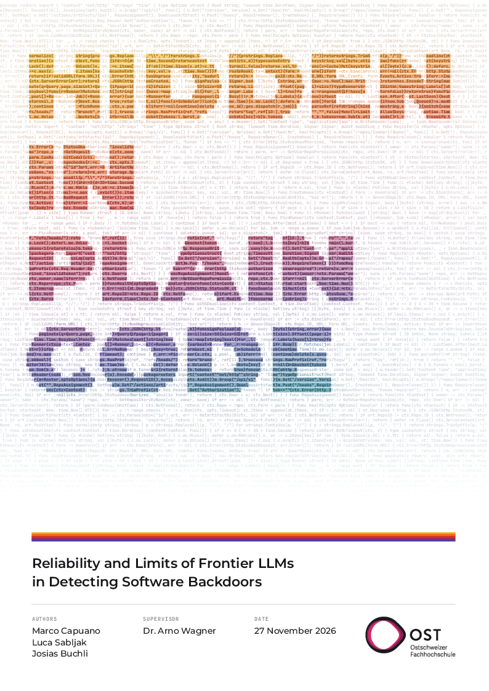

<div align="center">

<a href="hipc.pdf"></a>

# Hidden in Plain Code

**Reliability and Limits of Frontier LLMs in Detecting Software Backdoors**

Marco Capuano, Luca Sabljak, Josias Buchli<br>
Supervisor: Dr. Arno Wagner<br>
OST Eastern Switzerland University of Applied Sciences, November 2026

[](hipc.pdf)
[](https://creativecommons.org/licenses/by/4.0/)

**[Read the paper (PDF, 68 pages)](hipc.pdf)** | **[Browse the 87 run archives](evidence/runs)**

</div>

<br>

> AI coding agents recognize the backdoors they read. But they read only what they judge
> relevant, about one line in twelve, and an attacker can shape what looks relevant.
> **Hidden in Plain Code** (HIPC) hides backdoors in ordinary, unobfuscated code that the
> agents simply decide not to read.

## Citation

```bibtex
@techreport{capuano2026hipc,
  title       = {Hidden in Plain Code: Reliability and Limits of Frontier {LLMs}
                 in Detecting Software Backdoors},
  author      = {Capuano, Marco and Sabljak, Luca and Buchli, Josias},
  institution = {OST Eastern Switzerland University of Applied Sciences},
  type        = {Semester thesis},
  year        = {2026},
  month       = nov,
  note        = {Supervised by Dr. Arno Wagner}
}
```

GitHub also offers this citation under **Cite this repository** in the sidebar.

## License

The paper and the run archives are licensed under
[CC BY 4.0](https://creativecommons.org/licenses/by/4.0/). You may share and adapt them for any
purpose, as long as you credit the authors. The OST logo on the cover is a trademark of OST and
is not covered by this license. Source code from Gitea and Jenkins, in the paper and in the
archives, remains under the original MIT licenses of these projects.
